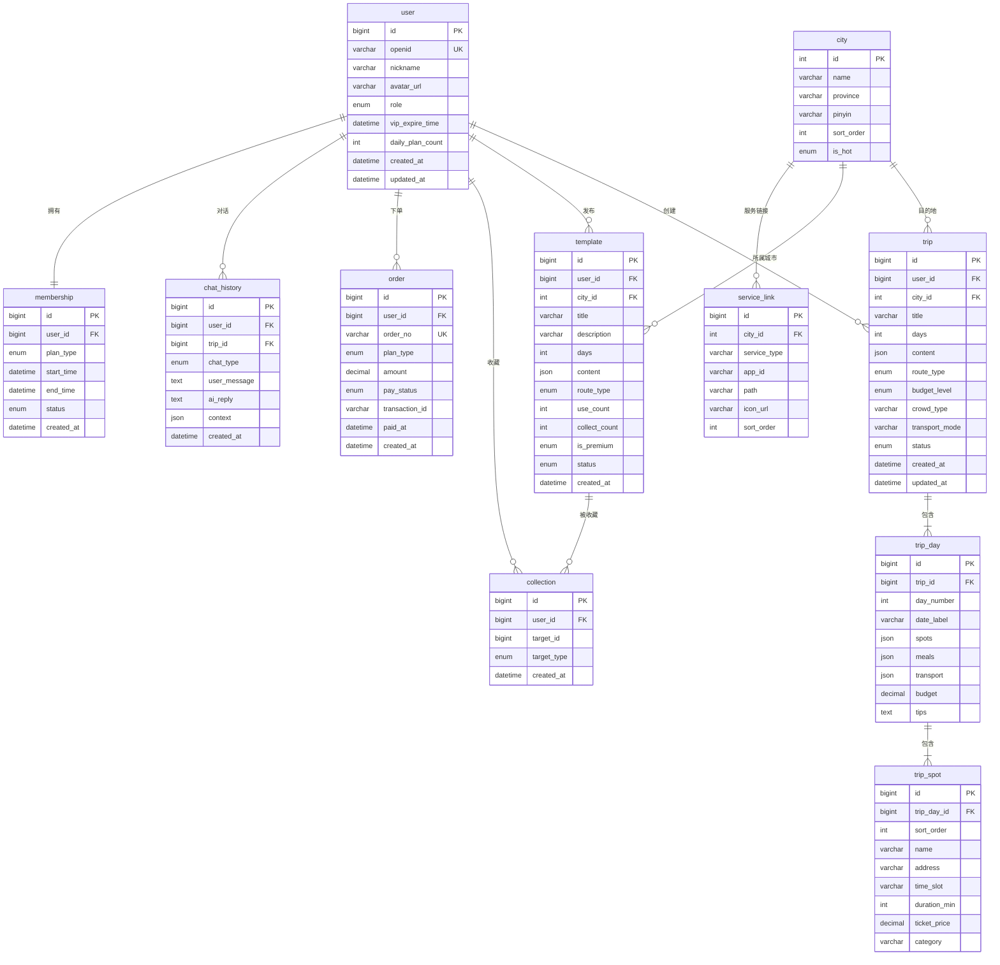

# 知途 AI 旅行 —— 数据库 ER 图设计文档

| 项目     | 内容                |
| :------- | :------------------ |
| 文档名称 | 数据库 ER 图设计文档 |
| 版本     | V1.0                |
| 编制时间 | 2026 年 08 月 06 日 |
| 数据库   | MySQL 8.0           |
| 字符集   | utf8mb4             |

---

## 一、ER 图总览



---

## 二、数据表详细设计

### 2.1 user 用户表

| 字段名             | 类型         | 约束        | 默认值  | 说明                         |
| :----------------- | :----------- | :---------- | :------ | :--------------------------- |
| id                 | BIGINT       | PK, AUTO    | -       | 主键 ID                      |
| openid             | VARCHAR(64)  | UK, NOT NULL| -       | 微信 openid                  |
| nickname           | VARCHAR(64)  | NULL        | NULL    | 用户昵称                     |
| avatar_url         | VARCHAR(512) | NULL        | NULL    | 头像 URL                     |
| role               | ENUM         | NOT NULL    | 'free'  | 角色：free / vip             |
| vip_expire_time    | DATETIME     | NULL        | NULL    | 会员到期时间                  |
| daily_plan_count   | INT          | NOT NULL    | 3       | 当日剩余生成次数              |
| daily_count_date   | DATE         | NULL        | NULL    | 当日次数计数日期（用于重置）   |
| created_at         | DATETIME     | NOT NULL    | NOW()   | 创建时间                     |
| updated_at         | DATETIME     | NOT NULL    | NOW()   | 更新时间                     |

**索引：**
- PRIMARY KEY (`id`)
- UNIQUE INDEX `uk_openid` (`openid`)

```sql
CREATE TABLE `user` (
    `id`                BIGINT       NOT NULL AUTO_INCREMENT,
    `openid`            VARCHAR(64)  NOT NULL,
    `nickname`          VARCHAR(64)  DEFAULT NULL,
    `avatar_url`        VARCHAR(512) DEFAULT NULL,
    `role`              ENUM('free','vip') NOT NULL DEFAULT 'free',
    `vip_expire_time`   DATETIME     DEFAULT NULL,
    `daily_plan_count`  INT          NOT NULL DEFAULT 3,
    `daily_count_date`  DATE         DEFAULT NULL,
    `created_at`        DATETIME     NOT NULL DEFAULT CURRENT_TIMESTAMP,
    `updated_at`        DATETIME     NOT NULL DEFAULT CURRENT_TIMESTAMP ON UPDATE CURRENT_TIMESTAMP,
    PRIMARY KEY (`id`),
    UNIQUE KEY `uk_openid` (`openid`)
) ENGINE=InnoDB DEFAULT CHARSET=utf8mb4 COMMENT='用户表';
```

---

### 2.2 membership 会员表

| 字段名        | 类型          | 约束        | 默认值  | 说明                          |
| :------------ | :------------ | :---------- | :------ | :---------------------------- |
| id            | BIGINT        | PK, AUTO    | -       | 主键 ID                       |
| user_id       | BIGINT        | FK, NOT NULL| -       | 用户 ID                       |
| plan_type     | ENUM          | NOT NULL    | -       | 套餐：monthly / yearly        |
| start_time    | DATETIME      | NOT NULL    | -       | 会员开始时间                   |
| end_time      | DATETIME      | NOT NULL    | -       | 会员到期时间                   |
| status        | ENUM          | NOT NULL    | 'active'| 状态：active / expired        |
| created_at    | DATETIME      | NOT NULL    | NOW()   | 创建时间                      |

**索引：**
- PRIMARY KEY (`id`)
- INDEX `idx_user_id` (`user_id`)

```sql
CREATE TABLE `membership` (
    `id`          BIGINT    NOT NULL AUTO_INCREMENT,
    `user_id`     BIGINT    NOT NULL,
    `plan_type`   ENUM('monthly','yearly') NOT NULL,
    `start_time`  DATETIME  NOT NULL,
    `end_time`    DATETIME  NOT NULL,
    `status`      ENUM('active','expired') NOT NULL DEFAULT 'active',
    `created_at`  DATETIME  NOT NULL DEFAULT CURRENT_TIMESTAMP,
    PRIMARY KEY (`id`),
    INDEX `idx_user_id` (`user_id`)
) ENGINE=InnoDB DEFAULT CHARSET=utf8mb4 COMMENT='会员表';
```

---

### 2.3 trip 行程表

| 字段名          | 类型         | 约束        | 默认值  | 说明                              |
| :-------------- | :----------- | :---------- | :------ | :-------------------------------- |
| id              | BIGINT       | PK, AUTO    | -       | 主键 ID                           |
| user_id         | BIGINT       | FK, NOT NULL| -       | 用户 ID                           |
| city_id         | INT          | FK, NOT NULL| -       | 目的地城市 ID                      |
| title           | VARCHAR(128) | NOT NULL    | -       | 行程标题                           |
| days            | INT          | NOT NULL    | -       | 出行天数（1-4）                    |
| content         | JSON         | NULL        | NULL    | 行程完整内容（冗余存储，快速读取）  |
| route_type      | ENUM         | NOT NULL    | 'popular'| 路线类型：popular(大众) / niche(小众) |
| budget_level    | ENUM         | NOT NULL    | 'comfort'| 预算档位：economy / comfort / luxury |
| crowd_type      | VARCHAR(32)  | NOT NULL    | -       | 出行人群：family/couple/student/senior/friend/other |
| transport_mode  | VARCHAR(32)  | NULL        | NULL    | 交通方式：self_drive/public/walk/mixed |
| plan_source     | ENUM         | NOT NULL    | 'form'  | 创建方式：form/quick/ocr/manual/template |
| status          | ENUM         | NOT NULL    | 'active'| 状态：active / archived / deleted  |
| created_at      | DATETIME     | NOT NULL    | NOW()   | 创建时间                           |
| updated_at      | DATETIME     | NOT NULL    | NOW()   | 更新时间                           |

**索引：**
- PRIMARY KEY (`id`)
- INDEX `idx_user_id` (`user_id`)
- INDEX `idx_city_id` (`city_id`)
- INDEX `idx_status` (`status`)

```sql
CREATE TABLE `trip` (
    `id`             BIGINT       NOT NULL AUTO_INCREMENT,
    `user_id`        BIGINT       NOT NULL,
    `city_id`        INT          NOT NULL,
    `title`          VARCHAR(128) NOT NULL,
    `days`           INT          NOT NULL,
    `content`        JSON         DEFAULT NULL,
    `route_type`     ENUM('popular','niche') NOT NULL DEFAULT 'popular',
    `budget_level`   ENUM('economy','comfort','luxury') NOT NULL DEFAULT 'comfort',
    `crowd_type`     VARCHAR(32)  NOT NULL,
    `transport_mode` VARCHAR(32)  DEFAULT NULL,
    `plan_source`    ENUM('form','quick','ocr','manual','template') NOT NULL DEFAULT 'form',
    `status`         ENUM('active','archived','deleted') NOT NULL DEFAULT 'active',
    `created_at`     DATETIME     NOT NULL DEFAULT CURRENT_TIMESTAMP,
    `updated_at`     DATETIME     NOT NULL DEFAULT CURRENT_TIMESTAMP ON UPDATE CURRENT_TIMESTAMP,
    PRIMARY KEY (`id`),
    INDEX `idx_user_id` (`user_id`),
    INDEX `idx_city_id` (`city_id`),
    INDEX `idx_status` (`status`)
) ENGINE=InnoDB DEFAULT CHARSET=utf8mb4 COMMENT='行程表';
```

---

### 2.4 trip_day 行程分日表

| 字段名       | 类型          | 约束        | 默认值 | 说明                         |
| :----------- | :------------ | :---------- | :----- | :--------------------------- |
| id           | BIGINT        | PK, AUTO    | -      | 主键 ID                      |
| trip_id      | BIGINT        | FK, NOT NULL| -      | 行程 ID                      |
| day_number   | INT           | NOT NULL    | -      | 第几天（1-4）                 |
| date_label   | VARCHAR(32)   | NULL        | NULL   | 日期标签（如"Day 1"/"第一天"）|
| spots        | JSON          | NULL        | NULL   | 当日景点列表（含名称/地址/时长/票价）|
| meals        | JSON          | NULL        | NULL   | 当日餐饮推荐                  |
| transport    | JSON          | NULL        | NULL   | 当日交通建议                  |
| budget       | DECIMAL(10,2) | NULL        | NULL   | 当日预算                     |
| tips         | TEXT          | NULL        | NULL   | 当日避坑提示                  |

**索引：**
- PRIMARY KEY (`id`)
- INDEX `idx_trip_id` (`trip_id`)

```sql
CREATE TABLE `trip_day` (
    `id`         BIGINT        NOT NULL AUTO_INCREMENT,
    `trip_id`    BIGINT        NOT NULL,
    `day_number` INT           NOT NULL,
    `date_label` VARCHAR(32)   DEFAULT NULL,
    `spots`      JSON          DEFAULT NULL,
    `meals`      JSON          DEFAULT NULL,
    `transport`  JSON          DEFAULT NULL,
    `budget`     DECIMAL(10,2) DEFAULT NULL,
    `tips`       TEXT          DEFAULT NULL,
    PRIMARY KEY (`id`),
    INDEX `idx_trip_id` (`trip_id`)
) ENGINE=InnoDB DEFAULT CHARSET=utf8mb4 COMMENT='行程分日表';
```

**spots JSON 结构示例：**
```json
[
    {
        "name": "西湖",
        "address": "杭州市西湖区龙井路1号",
        "time_slot": "上午",
        "duration_min": 180,
        "ticket_price": 0,
        "category": "自然风光",
        "description": "漫步苏堤，欣赏断桥残雪"
    }
]
```

**meals JSON 结构示例：**
```json
[
    {
        "name": "楼外楼",
        "type": "午餐",
        "avg_price": 120,
        "specialty": "西湖醋鱼、龙井虾仁",
        "address": "杭州市西湖区孤山路30号"
    }
]
```

---

### 2.5 trip_spot 行程点位表

| 字段名        | 类型          | 约束        | 默认值 | 说明                              |
| :----------- | :------------ | :---------- | :----- | :-------------------------------- |
| id           | BIGINT        | PK, AUTO    | -      | 主键 ID                           |
| trip_day_id  | BIGINT        | FK, NOT NULL| -      | 分日 ID                           |
| sort_order   | INT           | NOT NULL    | 0      | 排序序号                           |
| name         | VARCHAR(128)  | NOT NULL    | -      | 点位名称                           |
| address      | VARCHAR(256)  | NULL        | NULL   | 地址                              |
| time_slot    | VARCHAR(32)   | NULL        | NULL   | 时段：morning/afternoon/evening    |
| duration_min | INT           | NULL        | NULL   | 游玩时长（分钟）                   |
| ticket_price | DECIMAL(10,2) | NULL        | 0      | 门票价格                           |
| category     | VARCHAR(32)   | NULL        | NULL   | 类别：scenic/food/shopping/culture |

**索引：**
- PRIMARY KEY (`id`)
- INDEX `idx_trip_day_id` (`trip_day_id`)

```sql
CREATE TABLE `trip_spot` (
    `id`           BIGINT        NOT NULL AUTO_INCREMENT,
    `trip_day_id`  BIGINT        NOT NULL,
    `sort_order`   INT           NOT NULL DEFAULT 0,
    `name`         VARCHAR(128)  NOT NULL,
    `address`      VARCHAR(256)  DEFAULT NULL,
    `time_slot`    VARCHAR(32)   DEFAULT NULL,
    `duration_min` INT           DEFAULT NULL,
    `ticket_price` DECIMAL(10,2) DEFAULT 0,
    `category`     VARCHAR(32)   DEFAULT NULL,
    PRIMARY KEY (`id`),
    INDEX `idx_trip_day_id` (`trip_day_id`)
) ENGINE=InnoDB DEFAULT CHARSET=utf8mb4 COMMENT='行程点位表';
```

---

### 2.6 template 行程模板表

| 字段名         | 类型         | 约束        | 默认值   | 说明                          |
| :------------- | :----------- | :---------- | :------- | :---------------------------- |
| id             | BIGINT       | PK, AUTO    | -        | 主键 ID                       |
| user_id        | BIGINT       | FK, NOT NULL| -        | 发布者用户 ID                  |
| city_id        | INT          | FK, NOT NULL| -        | 所属城市 ID                    |
| title          | VARCHAR(128) | NOT NULL    | -        | 模板标题                       |
| description    | VARCHAR(512) | NULL        | NULL     | 模板简介                       |
| days           | INT          | NOT NULL    | -        | 行程天数                       |
| content        | JSON         | NOT NULL    | -        | 行程完整内容                   |
| route_type     | ENUM         | NOT NULL    | 'popular'| 路线类型                       |
| use_count      | INT          | NOT NULL    | 0        | 使用次数                       |
| collect_count  | INT          | NOT NULL    | 0        | 收藏次数                       |
| is_premium     | ENUM         | NOT NULL    | 'free'   | 是否付费：free / premium       |
| status         | ENUM         | NOT NULL    | 'pending'| 状态：pending/approved/rejected|
| created_at     | DATETIME     | NOT NULL    | NOW()    | 创建时间                       |

**索引：**
- PRIMARY KEY (`id`)
- INDEX `idx_city_id` (`city_id`)
- INDEX `idx_status` (`status`)
- INDEX `idx_is_premium` (`is_premium`)

```sql
CREATE TABLE `template` (
    `id`            BIGINT       NOT NULL AUTO_INCREMENT,
    `user_id`       BIGINT       NOT NULL,
    `city_id`       INT          NOT NULL,
    `title`         VARCHAR(128) NOT NULL,
    `description`   VARCHAR(512) DEFAULT NULL,
    `days`          INT          NOT NULL,
    `content`       JSON         NOT NULL,
    `route_type`    ENUM('popular','niche') NOT NULL DEFAULT 'popular',
    `use_count`     INT          NOT NULL DEFAULT 0,
    `collect_count` INT          NOT NULL DEFAULT 0,
    `is_premium`    ENUM('free','premium') NOT NULL DEFAULT 'free',
    `status`        ENUM('pending','approved','rejected') NOT NULL DEFAULT 'pending',
    `created_at`    DATETIME     NOT NULL DEFAULT CURRENT_TIMESTAMP,
    PRIMARY KEY (`id`),
    INDEX `idx_city_id` (`city_id`),
    INDEX `idx_status` (`status`),
    INDEX `idx_is_premium` (`is_premium`)
) ENGINE=InnoDB DEFAULT CHARSET=utf8mb4 COMMENT='行程模板表';
```

---

### 2.7 collection 收藏表

| 字段名       | 类型   | 约束        | 默认值 | 说明                              |
| :----------- | :----- | :---------- | :----- | :-------------------------------- |
| id           | BIGINT | PK, AUTO    | -      | 主键 ID                           |
| user_id      | BIGINT | FK, NOT NULL| -      | 用户 ID                           |
| target_id    | BIGINT | NOT NULL    | -      | 收藏目标 ID                        |
| target_type  | ENUM   | NOT NULL    | -      | 目标类型：trip / template          |
| created_at   | DATETIME | NOT NULL  | NOW()  | 收藏时间                           |

**索引：**
- PRIMARY KEY (`id`)
- UNIQUE INDEX `uk_user_target` (`user_id`, `target_id`, `target_type`)

```sql
CREATE TABLE `collection` (
    `id`          BIGINT   NOT NULL AUTO_INCREMENT,
    `user_id`     BIGINT   NOT NULL,
    `target_id`   BIGINT   NOT NULL,
    `target_type` ENUM('trip','template') NOT NULL,
    `created_at`  DATETIME NOT NULL DEFAULT CURRENT_TIMESTAMP,
    PRIMARY KEY (`id`),
    UNIQUE KEY `uk_user_target` (`user_id`, `target_id`, `target_type`)
) ENGINE=InnoDB DEFAULT CHARSET=utf8mb4 COMMENT='收藏表';
```

---

### 2.8 order 订单表

| 字段名          | 类型          | 约束        | 默认值  | 说明                              |
| :-------------- | :------------ | :---------- | :------ | :-------------------------------- |
| id              | BIGINT        | PK, AUTO    | -       | 主键 ID                           |
| user_id         | BIGINT        | FK, NOT NULL| -       | 用户 ID                           |
| order_no        | VARCHAR(64)   | UK, NOT NULL| -       | 订单编号                           |
| plan_type       | ENUM          | NOT NULL    | -       | 套餐：monthly / yearly            |
| amount          | DECIMAL(10,2) | NOT NULL    | -       | 金额                               |
| pay_status      | ENUM          | NOT NULL    | 'unpaid'| 支付状态：unpaid / paid / refunded |
| transaction_id  | VARCHAR(64)   | NULL        | NULL    | 微信支付交易号                     |
| paid_at         | DATETIME      | NULL        | NULL    | 支付时间                           |
| created_at      | DATETIME      | NOT NULL    | NOW()   | 创建时间                           |

**索引：**
- PRIMARY KEY (`id`)
- UNIQUE INDEX `uk_order_no` (`order_no`)
- INDEX `idx_user_id` (`user_id`)
- INDEX `idx_pay_status` (`pay_status`)

```sql
CREATE TABLE `order` (
    `id`             BIGINT        NOT NULL AUTO_INCREMENT,
    `user_id`        BIGINT        NOT NULL,
    `order_no`       VARCHAR(64)   NOT NULL,
    `plan_type`      ENUM('monthly','yearly') NOT NULL,
    `amount`         DECIMAL(10,2) NOT NULL,
    `pay_status`     ENUM('unpaid','paid','refunded') NOT NULL DEFAULT 'unpaid',
    `transaction_id` VARCHAR(64)  DEFAULT NULL,
    `paid_at`        DATETIME      DEFAULT NULL,
    `created_at`     DATETIME      NOT NULL DEFAULT CURRENT_TIMESTAMP,
    PRIMARY KEY (`id`),
    UNIQUE KEY `uk_order_no` (`order_no`),
    INDEX `idx_user_id` (`user_id`),
    INDEX `idx_pay_status` (`pay_status`)
) ENGINE=InnoDB DEFAULT CHARSET=utf8mb4 COMMENT='订单表';
```

---

### 2.9 chat_history 对话历史表

| 字段名        | 类型     | 约束        | 默认值 | 说明                              |
| :----------- | :------- | :---------- | :----- | :-------------------------------- |
| id           | BIGINT   | PK, AUTO    | -      | 主键 ID                           |
| user_id      | BIGINT   | FK, NOT NULL| -      | 用户 ID                           |
| trip_id      | BIGINT   | FK, NULL    | NULL   | 关联行程 ID（微调对话时填写）       |
| chat_type    | ENUM     | NOT NULL    | -      | 对话类型：adjust / qa             |
| user_message | TEXT     | NOT NULL    | -      | 用户消息                           |
| ai_reply     | TEXT     | NULL        | NULL   | AI 回复                            |
| context      | JSON     | NULL        | NULL   | 上下文（当前行程快照）              |
| created_at   | DATETIME | NOT NULL    | NOW()  | 创建时间                           |

**索引：**
- PRIMARY KEY (`id`)
- INDEX `idx_user_id` (`user_id`)
- INDEX `idx_trip_id` (`trip_id`)

```sql
CREATE TABLE `chat_history` (
    `id`           BIGINT   NOT NULL AUTO_INCREMENT,
    `user_id`      BIGINT   NOT NULL,
    `trip_id`      BIGINT   DEFAULT NULL,
    `chat_type`    ENUM('adjust','qa') NOT NULL,
    `user_message` TEXT     NOT NULL,
    `ai_reply`     TEXT     DEFAULT NULL,
    `context`      JSON     DEFAULT NULL,
    `created_at`   DATETIME NOT NULL DEFAULT CURRENT_TIMESTAMP,
    PRIMARY KEY (`id`),
    INDEX `idx_user_id` (`user_id`),
    INDEX `idx_trip_id` (`trip_id`)
) ENGINE=InnoDB DEFAULT CHARSET=utf8mb4 COMMENT='对话历史表';
```

---

### 2.10 city 城市表

| 字段名      | 类型        | 约束        | 默认值 | 说明                |
| :---------- | :---------- | :---------- | :----- | :------------------ |
| id          | INT         | PK, AUTO    | -      | 主键 ID             |
| name        | VARCHAR(32) | NOT NULL    | -      | 城市名称            |
| province    | VARCHAR(32) | NULL        | NULL   | 省份                |
| pinyin      | VARCHAR(64) | NULL        | NULL   | 拼音（用于排序搜索） |
| sort_order  | INT         | NOT NULL    | 0      | 排序序号            |
| is_hot      | ENUM        | NOT NULL    | 'no'   | 是否热门：yes / no   |

**索引：**
- PRIMARY KEY (`id`)
- INDEX `idx_is_hot` (`is_hot`)

```sql
CREATE TABLE `city` (
    `id`         INT          NOT NULL AUTO_INCREMENT,
    `name`       VARCHAR(32)  NOT NULL,
    `province`   VARCHAR(32)  DEFAULT NULL,
    `pinyin`     VARCHAR(64)  DEFAULT NULL,
    `sort_order` INT          NOT NULL DEFAULT 0,
    `is_hot`     ENUM('yes','no') NOT NULL DEFAULT 'no',
    PRIMARY KEY (`id`),
    INDEX `idx_is_hot` (`is_hot`)
) ENGINE=InnoDB DEFAULT CHARSET=utf8mb4 COMMENT='城市表';
```

---

### 2.11 service_link 服务跳转链接表

| 字段名       | 类型         | 约束        | 默认值 | 说明                              |
| :----------- | :----------- | :---------- | :----- | :-------------------------------- |
| id           | BIGINT       | PK, AUTO    | -      | 主键 ID                           |
| city_id      | INT          | FK, NULL    | NULL   | 城市 ID（NULL 表示通用）           |
| service_type | VARCHAR(32)  | NOT NULL    | -      | 服务类型：navigate/taxi/ride/hotel/food/ticket/movie 等 |
| app_id       | VARCHAR(64)  | NOT NULL    | -      | 目标小程序 AppID                   |
| path         | VARCHAR(512) | NULL        | NULL   | 跳转路径（可含参数占位符）          |
| icon_url     | VARCHAR(512) | NULL        | NULL   | 图标 URL                          |
| sort_order   | INT          | NOT NULL    | 0      | 排序序号                           |

**索引：**
- PRIMARY KEY (`id`)
- INDEX `idx_city_id` (`city_id`)
- INDEX `idx_service_type` (`service_type`)

```sql
CREATE TABLE `service_link` (
    `id`           BIGINT       NOT NULL AUTO_INCREMENT,
    `city_id`      INT          DEFAULT NULL,
    `service_type` VARCHAR(32)  NOT NULL,
    `app_id`       VARCHAR(64)  NOT NULL,
    `path`         VARCHAR(512) DEFAULT NULL,
    `icon_url`     VARCHAR(512) DEFAULT NULL,
    `sort_order`   INT          NOT NULL DEFAULT 0,
    PRIMARY KEY (`id`),
    INDEX `idx_city_id` (`city_id`),
    INDEX `idx_service_type` (`service_type`)
) ENGINE=InnoDB DEFAULT CHARSET=utf8mb4 COMMENT='服务跳转链接表';
```

---

## 三、表关系说明

| 关系               | 类型      | 说明                              |
| :----------------- | :-------- | :-------------------------------- |
| user → trip        | 1 : N     | 一个用户创建多个行程               |
| user → template    | 1 : N     | 一个用户发布多个模板               |
| user → collection  | 1 : N     | 一个用户收藏多个行程/模板           |
| user → order       | 1 : N     | 一个用户产生多个订单               |
| user → chat_history| 1 : N     | 一个用户有多条对话记录              |
| user → membership  | 1 : 1     | 一个用户对应一条会员记录            |
| trip → trip_day    | 1 : N     | 一个行程包含多个分日                |
| trip_day → trip_spot| 1 : N    | 一个分日包含多个点位                |
| city → trip        | 1 : N     | 一个城市对应多个行程               |
| city → template    | 1 : N     | 一个城市对应多个模板               |
| city → service_link| 1 : N     | 一个城市对应多个服务链接            |
| template → collection| 1 : N   | 一个模板被多个用户收藏              |

---

## 四、Redis 缓存设计

| Key 格式                           | 类型   | TTL     | 说明                        |
| :--------------------------------- | :----- | :------ | :-------------------------- |
| `user:daily_count:{user_id}:{date}` | String | 到当日24点 | 用户当日生成次数             |
| `template:hot:list`                | List   | 7 天    | 热门模板列表缓存              |
| `template:detail:{template_id}`    | String | 1 天    | 模板详情缓存                 |
| `trip:content:{trip_id}`           | String | 1 小时  | 行程内容缓存                 |
| `city:list`                        | String | 7 天    | 城市列表缓存                 |
| `service_link:city:{city_id}`     | String | 7 天    | 城市服务链接缓存              |
| `user:info:{user_id}`             | Hash   | 1 小时  | 用户信息缓存                 |
| `llm:cache:{md5(prompt)}`         | String | 7 天    | LLM 相同请求结果缓存          |
