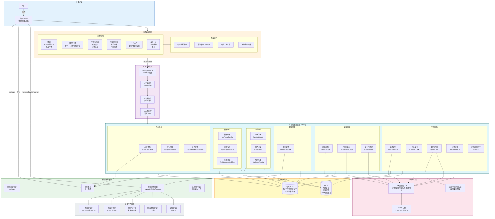
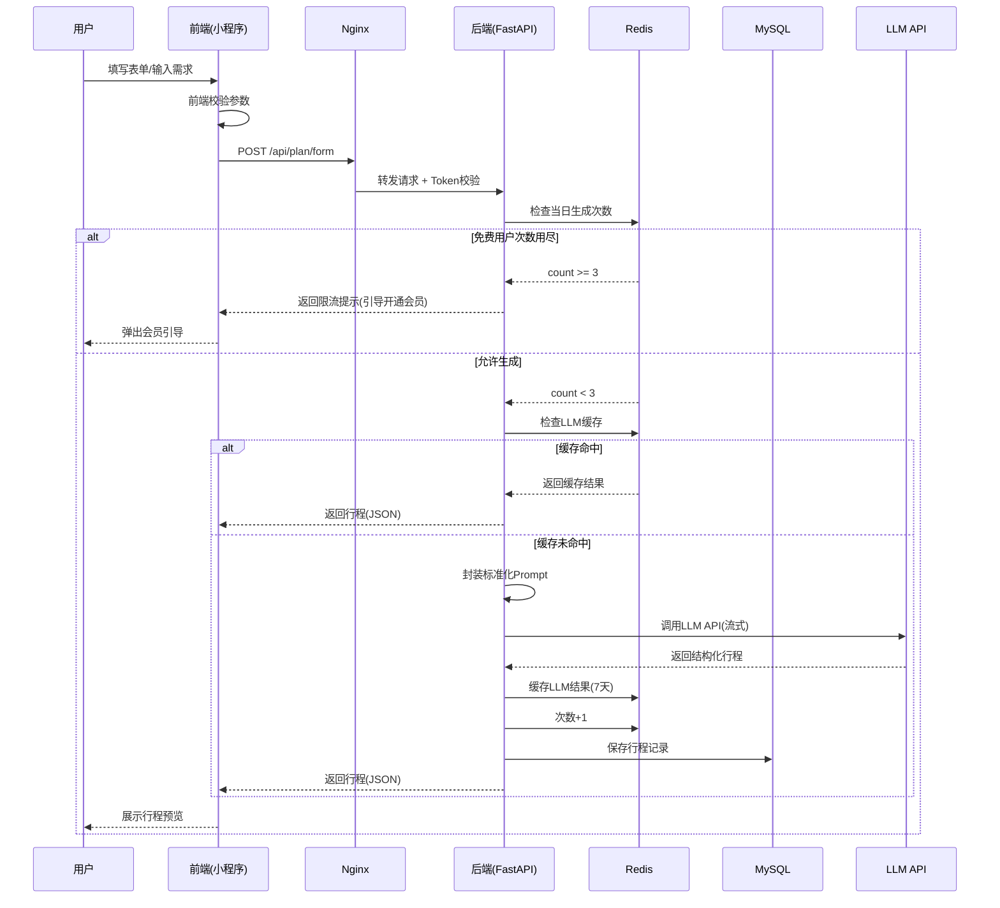
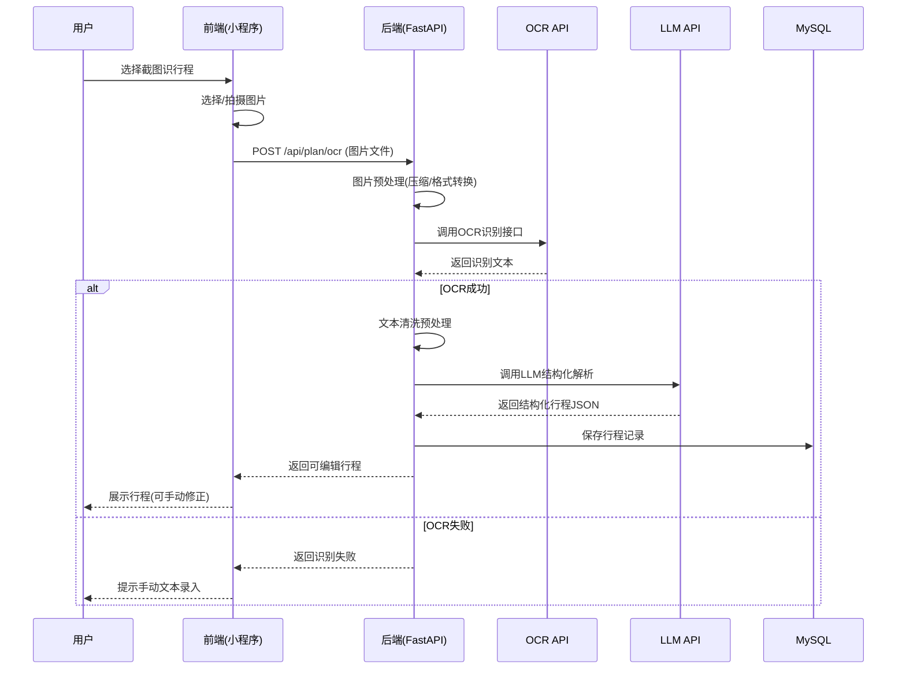
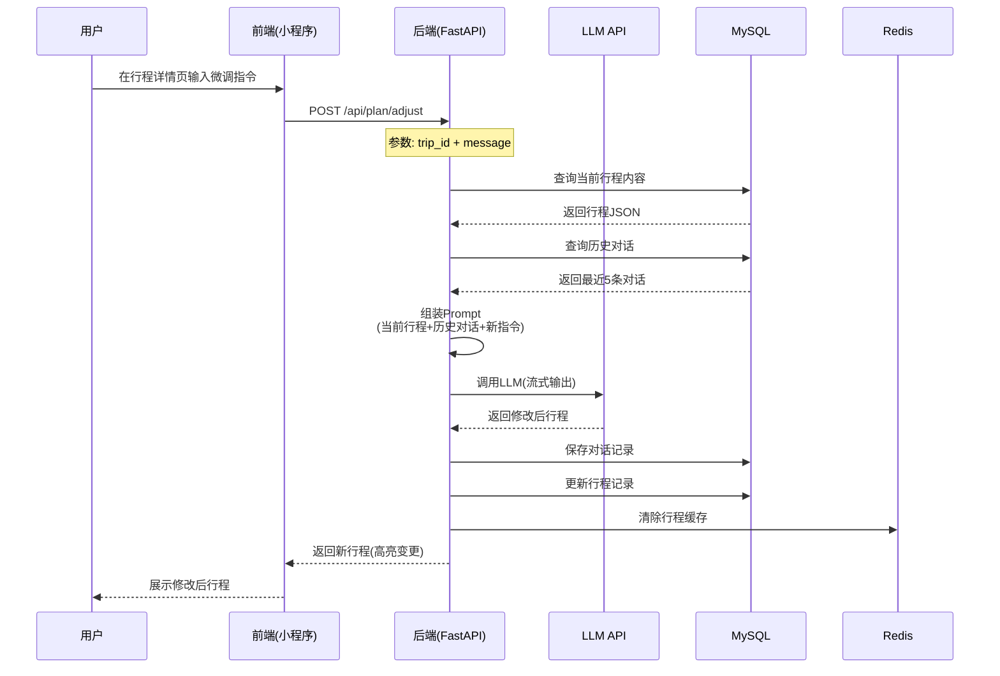
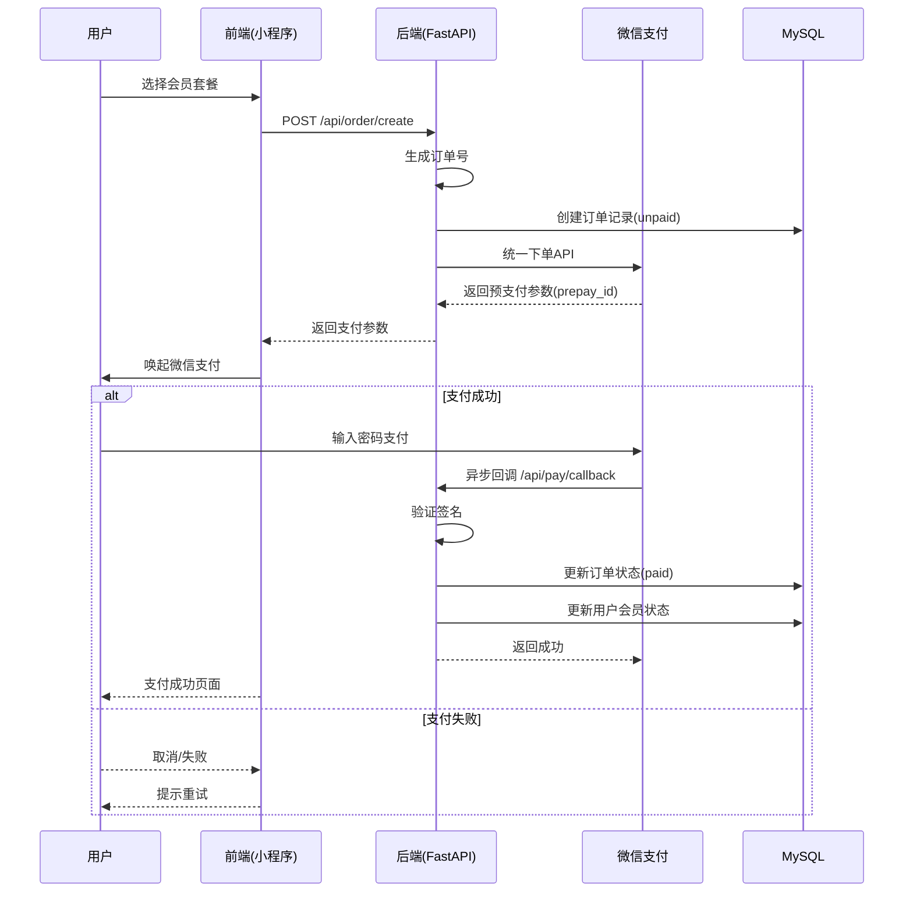
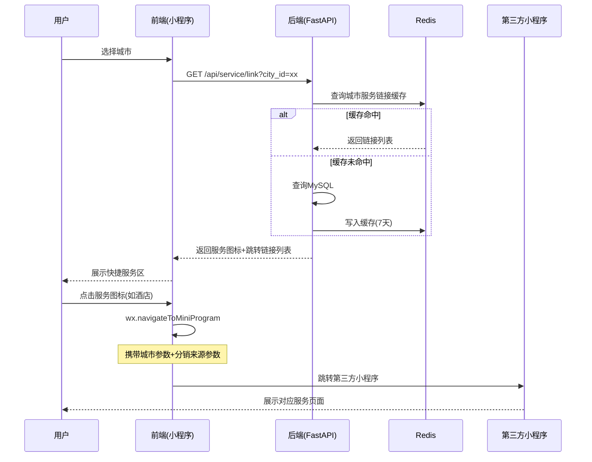
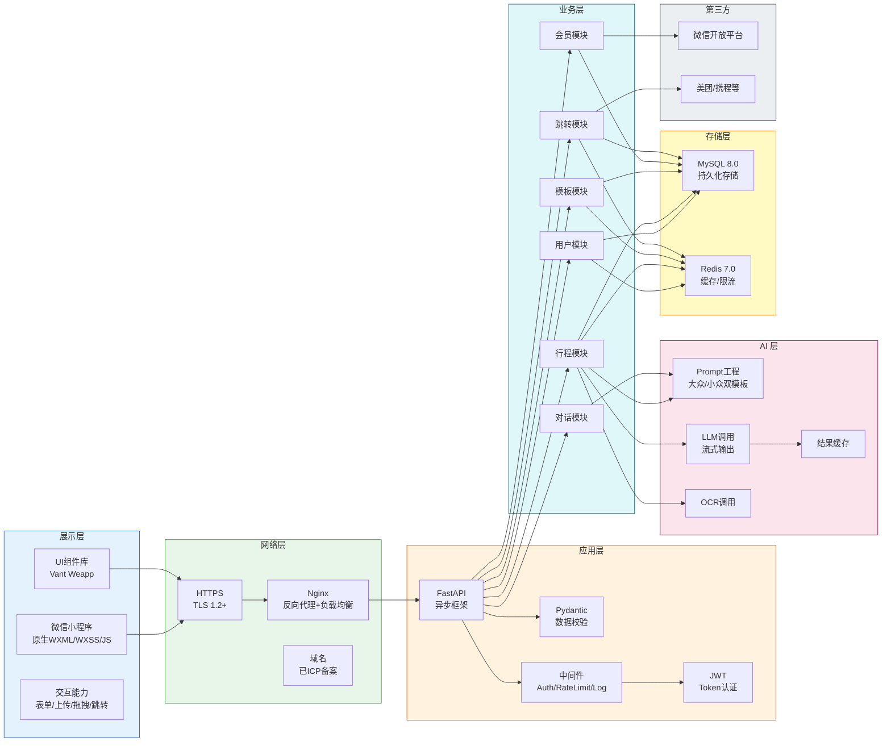
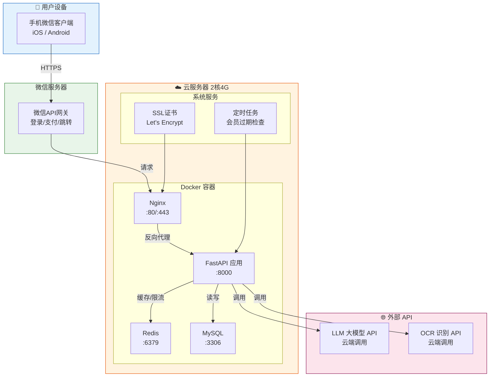
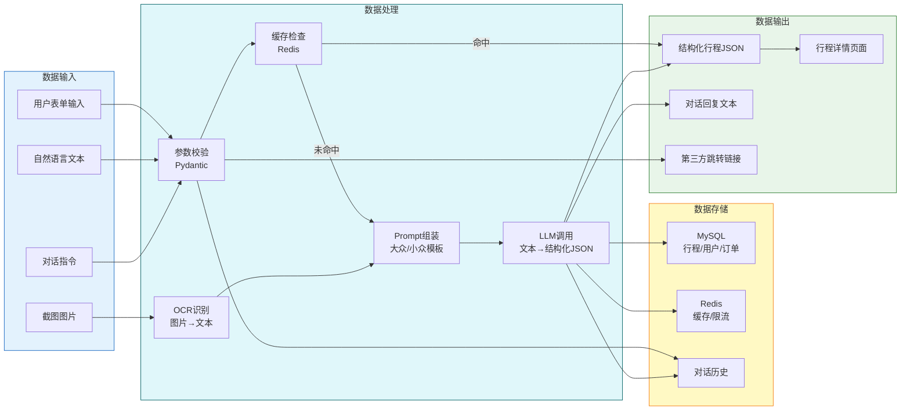
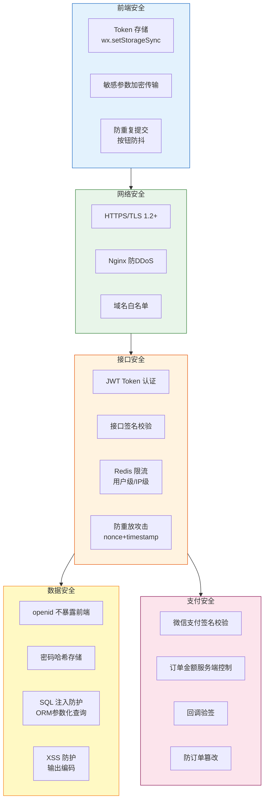

# 知途 AI 旅行 —— 系统架构图

| 项目     | 内容              |
| :------- | :---------------- |
| 文档名称 | 系统架构图        |
| 版本     | V1.0              |
| 编制时间 | 2026 年 08 月 06 日 |

---

## 一、系统整体架构图

---

## 二、核心业务流程架构图

### 2.1 AI 行程生成流程

### 2.2 截图识行程流程

### 2.3 对话微调行程流程

### 2.4 会员支付流程

### 2.5 快捷服务跳转流程

---

## 三、技术分层架构图

---

## 四、部署架构图

---

## 五、数据流架构图

---

## 六、安全架构图

